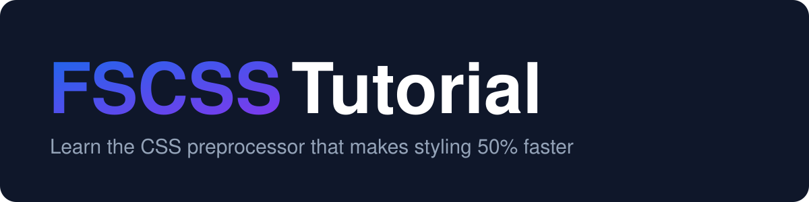

# FSCSS Tutorial — Learn the FSCSS CSS Preprocessor

[](https://www.npmjs.com/package/fscss)
[](https://www.npmjs.com/package/fscss)
[](https://github.com/fscss-ttr/FSCSS)
[](https://github.com/fscss-ttr/tutorial)
[](https://fscss.devtem.org/)
[](https://fscss.devtem.org/ide)



**Learn FSCSS from scratch** — the lightweight CSS preprocessor that makes writing CSS about **50% faster**. This free, complete **FSCSS tutorial** takes you from your first variable to production-ready stylesheets, with **50 real-world projects** along the way.

FSCSS (Figured Shorthand CSS) is a modern CSS preprocessor that simplifies your styling workflow with an intuitive shorthand syntax. You get variables, reusable blocks, design-token stores, arrays, loops, and conditional logic — without a heavy build pipeline.

---

## Table of Contents

- [What is FSCSS?](#what-is-fscss)
- [Why Learn FSCSS?](#why-learn-fscss)
- [Tutorial Structure](#tutorial-structure)
- [Quick Start](#quick-start)
- [Who Is This Tutorial For?](#who-is-this-tutorial-for)
- [How to Use This Tutorial](#how-to-use-this-tutorial)
- [Prerequisites](#prerequisites)
- [Frequently Asked Questions](#frequently-asked-questions)
- [Who Made FSCSS?](#who-made-fscss)
- [Resources](#resources)
- [Contributing](#contributing)
- [License](#license)

---

## What is FSCSS?

FSCSS (**Figured Shorthand CSS**) is a modern, lightweight **CSS preprocessor**. It extends ordinary CSS with shorthand syntax so you can write cleaner, more maintainable stylesheets with far less code:

- `$name` variables for reusable values
- `@define` blocks for reusable, parameterized rules
- `@fun` stores for design tokens (color, spacing, type)
- `@arr` arrays and `count()` loops to generate CSS from data
- `@event` for conditional values, themes, and dark mode

FSCSS runs either as a **CLI build step** (compiles to plain CSS) or as a tiny **browser runtime** via CDN — no complex tooling required.

## Why Learn FSCSS?

- **Write CSS faster** — shorthand syntax means fewer keystrokes and less repetition
- **Cleaner code** — variables, style stores, and reusable blocks keep stylesheets DRY
- **Lightweight** — no heavy dependencies or complicated build steps
- **Flexible** — use it via npm, CDN, or the CLI, in any stack
- **Modern** — built for today's workflows, with theming, tokens, and data-driven output

## Tutorial Structure

| Section | Level | Lessons | Description |
|---------|-------|---------|-------------|
| [Introduction](./01-introduction/) | Beginner | 5 | What FSCSS is, why it matters, how it compares |
| [Installation](./02-installation/) | Setup | 5 | npm, CDN, CLI, and multi-stack setups |
| [Beginner](./03-beginner/) | Beginner | 6 | Variables, shorthand, selectors, first project |
| [Intermediate](./04-intermediate/) | Intermediate | 16 | @define, @fun, loops, modules, patterns |
| [Advanced](./05-advanced/) | Advanced | 21 | Plugins, frameworks, CI/CD, performance |
| [Expert](./06-expert/) | Expert | 6 | Internals, compilers, enterprise, future |
| [Projects](./07-projects/) | All Levels | 51 | 50 real-world projects with step-by-step guides |

## Quick Start

Install FSCSS from npm:

```bash
npm install fscss@latest
```

Write a stylesheet:

```fscss
$primary: #2563eb;

.btn {
  background: $primary;
  color: white;
  padding: 12px 24px;
}
```

Compile it to CSS:

```bash
fscss style.fscss style.css
```

Prefer no build step? Load the runtime from a CDN instead:

```html
<script src="https://cdn.jsdelivr.net/npm/fscss@1.2.1/runtime.min.js" async></script>
```

## Who Is This Tutorial For?

- **CSS developers** who want a faster way to write styles
- **Beginners** learning their first modern CSS preprocessor
- **Front-end teams** standardizing on design tokens and themes
- **Anyone** who wants cleaner, more maintainable CSS

## How to Use This Tutorial

1. **Start with the Introduction** — understand what FSCSS is and why it exists
2. **Follow the Installation guide** — set up npm, CDN, or the CLI
3. **Work through Beginner** — learn the core syntax
4. **Progress to Intermediate** — master reusable code and functions
5. **Tackle Advanced** — build real, data-driven interfaces
6. **Challenge yourself with Expert** — design modules and understand internals
7. **Build the Projects** — apply everything across 50 real-world builds

## Prerequisites

- Basic understanding of HTML and CSS
- A code editor (VS Code recommended)
- Node.js installed (for the npm installation path)

## Frequently Asked Questions

### Is FSCSS free to use?

Yes. FSCSS is open source and released under the [MIT License](https://github.com/fscss-ttr/FSCSS), and this tutorial is free to read, share, and reuse.

### Do I need to know Sass or Less first?

No. The Beginner section teaches FSCSS from zero, and explains how it compares to Sass, Less, and Tailwind.

### How long does it take to learn FSCSS?

Most developers can write their first useful FSCSS stylesheet in under an hour, and work comfortably through data-driven patterns in a weekend. The 50 projects are ordered by difficulty so you can grow at your own pace.

### Can I use FSCSS in React, Vue, Next.js, or plain HTML?

Yes. FSCSS compiles to standard CSS, so it works with any framework or static page. See [FSCSS with Frameworks](./05-advanced/frameworks.md) for integration examples.

### Does FSCSS work without a build step?

Yes. Use the browser runtime via CDN for instant, no-build styling, or the CLI when you want zero-runtime production CSS. The difference is covered in [Runtime vs CLI](./03-beginner/runtime-vs-cli.md).

### What is the difference between FSCSS and Sass or Tailwind?

Sass adds programming to CSS but needs compilation and has heavier syntax; Tailwind moves styling into utility classes in your markup. FSCSS keeps styles in CSS with a lighter shorthand and optional runtime. See [Why FSCSS Over Others](./01-introduction/fscss-vs-tailwind.md).

## Who Made FSCSS?

FSCSS was created by **Ekuyik Sam (Mr. Figsh)**, a developer from Nigeria. He's the founder of the [fscss-ttr](https://github.com/fscss-ttr) organization on GitHub.

## Resources

- [FSCSS Documentation](https://fscss.devtem.org/)
- [GitHub Repository](https://github.com/fscss-ttr/FSCSS)
- [NPM Package](https://www.npmjs.com/package/fscss)
- [Community Discussions](https://github.com/fscss-ttr/FSCSS/discussions)

## Contributing

Found a typo, an error, or a missing example? Contributions are welcome:

1. Fork this repository.
2. Create a branch for your change.
3. Open a pull request describing the fix.

For questions and ideas, start a thread in [Community Discussions](https://github.com/fscss-ttr/FSCSS/discussions).

## License

MIT License. Built with care for the web development community.

---

**Ready to start? Begin with the [Introduction](./01-introduction/).**

---

*Written by [Omonire](https://github.com/Omonire)*
